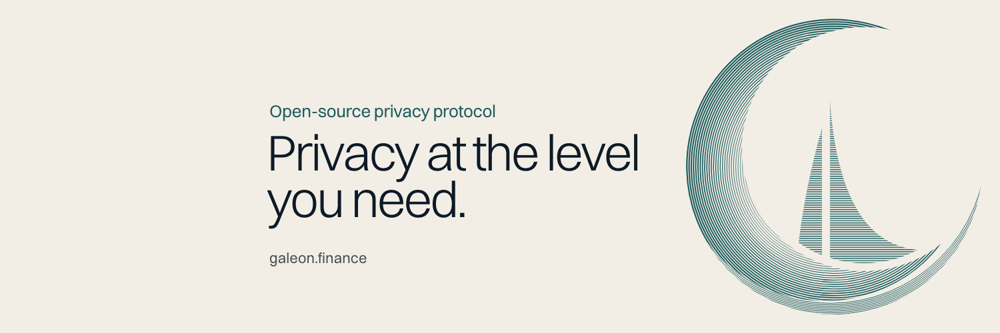

**Galeon** is an open-source privacy protocol. People get paid through private links (EIP-5564 stealth addresses), move funds through a privacy pool that only admits approved deposits, and can prove where their money came from without exposing anything else.

Privacy is a right. Compliance is a responsibility. Galeon is built for both.

- **[galeon](https://github.com/galeonprotocol/galeon)**: contracts, circuits, SDK and the reference app
- **Website:** [galeon.finance](https://www.galeon.finance)

Built in Colombia by Cartagena Onchain SAS.
